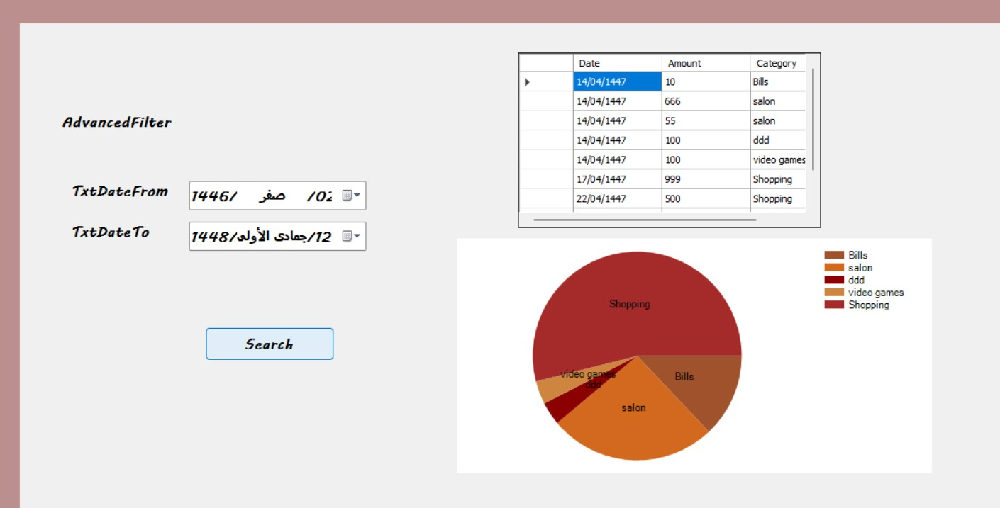
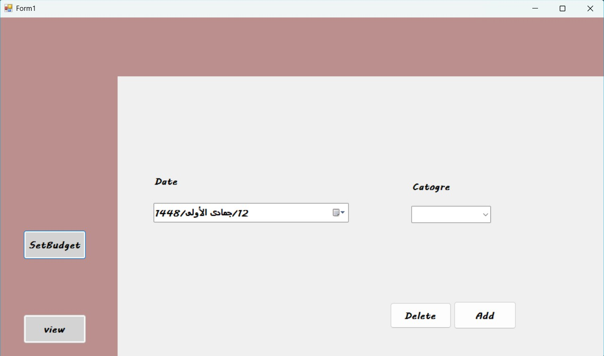
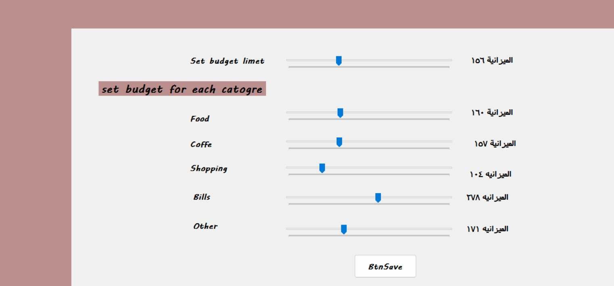

# 💸 Personal Budget Management System

### Track expenses. Organize budgets. Understand where your money goes.

A Windows desktop application built with **C# and Windows Forms**, featuring transaction entry, category budgets, date-based expense search and visual summaries.

  

**[Explore the interface](#-actual-application-screenshots) · [Features](#-features) · [Run locally](#-run-the-application)**

---

## 📸 Real application screenshots

The following screenshots were captured from the Windows Forms application running locally.

### Expense history and spending breakdown

### Record an expense

### Set category budgets

## 🚀 Features

- **Expense entry:** Record a transaction's date, amount and category.
- **Custom categories:** Choose Food, Transport or Shopping, or enter a category under Other.
- **Input validation:** Check positive amounts, required categories and future dates.
- **Budget controls:** Adjust category budget values with sliders and receive threshold-based warnings.
- **Transaction history:** Search expenses between selected dates and review matching records in a table.
- **Visual breakdown:** Display category spending totals using a pie chart.
- **Local persistence:** Save transactions and budget settings to CSV files.

## 🧭 How it works

`Add a transaction` → `Choose a category` → `Save to CSV` → `Search by date` → `Review chart`

Budget settings are configured and saved in a separate window.

## 🛠️ Technology stack

| Area | Technology |
| --- | --- |
| Programming language | C# |
| Desktop UI | Windows Forms |
| Runtime | .NET Framework 4.7.2 |
| Visualization | System.Windows.Forms.DataVisualization |
| Data queries | LINQ |
| Local storage | CSV files |
| Development | Visual Studio |

## ▶️ Run the application

1. Download or clone the repository.
2. Open **`WindowsFormsApp1.sln`** in Visual Studio on Windows.
3. Install the **.NET desktop development** workload and **.NET Framework 4.7.2 targeting pack** if prompted.
4. Set `WindowsFormsApp1` as the startup project.
5. Build the solution and press **F5** to run.

**Privacy:** Use sample transactions for demonstrations. Local `transactions.csv` and `budgets.csv` files may contain personal financial information and should not be committed.

## 📁 Source code guide

| File | Purpose |
| --- | --- |
| `Program.cs` | Application startup |
| `Form1.cs` | Transaction entry and validation |
| `TransactionManager.cs` | CSV transaction saving and loading |
| `Budget.cs` | Budget sliders, warning messages and CSV saving |
| `View.cs` | Date filtering, transaction table and pie chart |
| `CsvHelper.cs` | Additional CSV utilities |
| `WindowsFormsApp1.csproj` | Project configuration |

The source files and solution are located at the **repository root**.

## 🔎 Notes and improvement opportunities

This repository is a learning/portfolio project. The source has been reviewed, but the current version has **not been independently compiled or end-to-end tested** in this review.

- Budget warnings currently respond to **slider values**, not a comparison between real expenses and budget limits.
- The transaction writer stores a formatted date, while the reader interprets it as a **Hijri date**. Date parsing should be made consistent before relying on historical searches.
- CSV parsing is basic and does not handle quoted fields or category names containing commas.
- Existing `bin/` and `obj/` artifacts were committed in earlier history. The `.gitignore` prevents new untracked artifacts but does not remove already tracked files.
- The repository is currently a **fork**. Fork status and existing Git history are not changed by this README.

## 👩‍💻 Developer

**Nihal Hameed Alharbi**  
Computer Science  
[GitHub profile](https://github.com/niha-hameed)

---

*An exploration of practical desktop development, file persistence and spending visualization with C#.*

